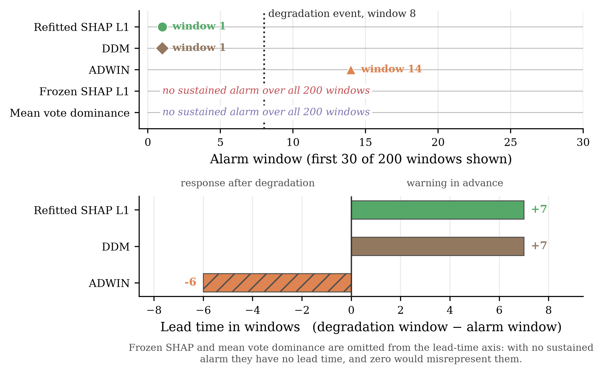
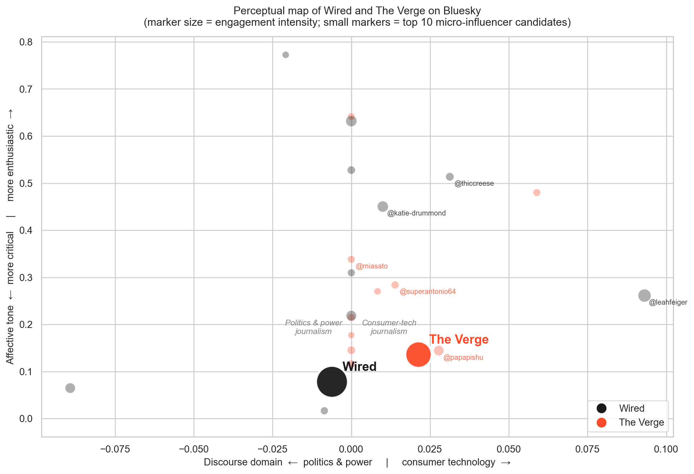
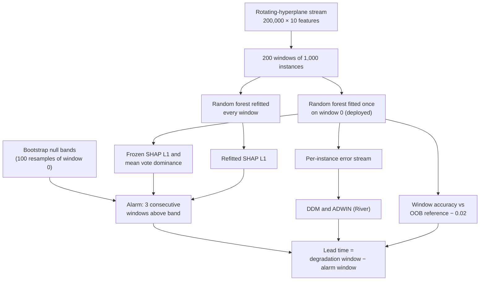

# UoN Business Analytics

Coursework, research code and revision notes from the MSc in Business Analytics at the University of Nottingham (2025/26), with one self-contained folder per module.

[](LICENSE)
[](#prerequisites)
[](https://github.com/shreyuu/UoN-Business-Analytics/actions/workflows/dissertation.yml)

## Overview

This repository archives a year of applied analytics work: Jupyter notebooks, the datasets that can be shared, trained models, figures and submitted reports. It is not a single application but a set of independent module workspaces, written for readers evaluating the work and kept as the author's reference archive. The centrepiece is the dissertation, which tests whether watching *how a model uses its features* (SHAP importance and random-forest vote dominance) can flag concept drift before accuracy falls. It benchmarks those signals against the DDM and ADWIN drift detectors.

<!-- TODO: add a sentence on status and what's next (e.g. outcome, planned follow-ups) -->

## Contents

- [Highlights](#highlights)
- [Modules](#modules)
- [Selected results](#selected-results)
- [Tech stack](#tech-stack)
- [Architecture](#architecture)
- [Getting started](#getting-started)
- [Usage](#usage)
- [Project structure](#project-structure)
- [Testing and verification](#testing-and-verification)
- [Known limitations](#known-limitations)
- [Contributing and conventions](#contributing-and-conventions)
- [License](#license)
- [Author](#author)

## Highlights

- **Feature-drift detection (dissertation, BUSI4374).** Refitted SHAP, frozen SHAP and random-forest vote-dominance signals are compared with DDM and ADWIN on a 200,000-instance rotating-hyperplane stream, using bootstrap-calibrated alarm bands, permutation negative controls and a Boolean harness whose feature reliance is known exactly.
- **Customer churn on Databricks (BUSI4373).** Spark SQL features over 4 × 14-day tumbling windows, a churn label whose 49-day inactivity threshold is backed by a sensitivity analysis, and out-of-time train, validation and test periods. The tuned random forest scores ROC-AUC 0.872 on the held-out test period.
- **Bluesky brand analytics (BUSI4370 CW2).** A seven-notebook pipeline compares Wired and The Verge: AT Protocol collection, cleaning, engagement analysis, VADER sentiment, LDA topics with coherence-based model selection, keyword networks, micro-influencer scoring and a perceptual map.
- **Customer segmentation (BUSI4370 CW1).** RFM and category-share features, PCA and K-means, with elbow and silhouette diagnostics and Adjusted Rand Index stability checks. The final solution has five segments over 3,000 customers.
- **Leakage-aware subscription classifier (BUSI4371).** Six models, including a majority-class baseline, are compared with cross-validated predictions while the call `duration` field is excluded. The selected Decision Tree pipeline is exported with joblib.
- **Supply-chain mapping (BUSI4496).** The UK solar-panel supply chain is drawn as Mermaid flowcharts covering supplier tiers, lead times, freight and distribution.

## Modules

| Folder | Module | Contents |
| --- | --- | --- |
| [`Dissertation/`](Dissertation/) | BUSI4374 Data Driven Dissertation Project in Business Analytics | Drift-detection study: [submitted notebooks](Dissertation/final%20submission/20811152_BUSI4374_2526/README.md), figures, chapter drafts |
| [`Machine-Learning-and-Predictive-Analytics/`](Machine-Learning-and-Predictive-Analytics/) | BUSI4373 Machine Learning and Predictive Analytics | [Churn-prediction coursework](Machine-Learning-and-Predictive-Analytics/BUSI4373_CW/BUSI4373_20811152_2526.ipynb), Databricks bundle scaffold, practical notebooks, revision notes |
| [`Analytics-Specializations-and-Applications/`](Analytics-Specializations-and-Applications/) | BUSI4370 Analytics Specializations and Applications | [CW1 segmentation](Analytics-Specializations-and-Applications/BUSI4370_CW1/README.md), [CW2 Bluesky analytics](Analytics-Specializations-and-Applications/BUSI4370_CW2/README.md), weekly case studies |
| [`FBA/`](FBA/) | BUSI4371 Foundational Business Analytics | Weekly Python practice (weeks 1 and 6–10, plus two Week 8 tests) and the [classifier coursework](FBA/coursework/README.md) |
| [`D@S/`](D%40S/) | BUSI4369 Data at Scale | Databricks and SQL coursework, a group KPI notebook and Tableau workbook, session slides |
| [`Supply-Chain-planning-and-management/`](Supply-Chain-planning-and-management/) | BUSI4496 Supply Chain Planning and Management | Mermaid supply-chain maps, lecture material, tutorial solutions |
| [`Leading-Big-Data-Business-Projects/`](Leading-Big-Data-Business-Projects/) | BUSI4372 Leading Big Data Business Projects | Group project report, slides, recorded presentation, meeting minutes |
| [`fractal/`](fractal/) | Not a module | Scratch Julia-set experiment, not coursework |

## Selected results

### Dissertation: when each detector fires



| Signal or detector | Needs labels | First sustained alarm | Lead time |
| --- | --- | --- | --- |
| Refitted SHAP L1 | Yes | Window 1 | +7 windows |
| DDM | Yes | Window 1 | +7 windows |
| ADWIN | Yes | Window 14 | −6 windows |
| Frozen SHAP L1 | No | None in 200 windows | None |
| Mean vote dominance | No | None in 200 windows | None |

Degradation is the first window where the deployed model's accuracy stays below its out-of-bag reference minus 0.02 (0.8330 − 0.02 = 0.8130) for three consecutive windows, which happens at window 8. The refitted SHAP signal ties DDM rather than beating it. The label-free frozen signals stay silent, which is what the dissertation predicts when P(X) is stationary and only P(y | X) changes. All values come from the canonical result cell of the [main notebook](Dissertation/final%20submission/20811152_BUSI4374_2526/20811152_BUSI4374_2526_main.ipynb).

### Bluesky brand analytics: perceptual map



The map is built from 1,578 Wired and 1,153 The Verge posts kept after cleaning, out of 2,500 and 1,946 collected. Its axes are discourse domain (politics and power through to consumer technology) and affective tone, and the small markers are the top micro-influencer candidates.

<!-- TODO: add a live demo link (e.g. nbviewer or Binder) if you publish one -->

## Tech stack

| Area | Tools |
| --- | --- |
| Languages | Python, SQL (Spark SQL on Databricks) |
| Data and ML | pandas, NumPy, SciPy, scikit-learn, matplotlib, seaborn, joblib |
| Drift detection and explainability | SHAP, River (DDM, ADWIN) |
| NLP and networks | NLTK, TextBlob, vaderSentiment, gensim (LDA), wordcloud, NetworkX, atproto |
| Platforms | Jupyter, Databricks (PySpark, Spark SQL, Asset Bundles), Tableau, Mermaid, Git LFS |

Versions are pinned in two places:

- **Dissertation**, in [`Dissertation/requirements.txt`](Dissertation/requirements.txt), matching its [submission README](Dissertation/final%20submission/20811152_BUSI4374_2526/README.md): Python 3.12.12, scikit-learn 1.9.0, NumPy 2.5.2, pandas 3.0.5, SHAP 0.52.0, River 0.25.0, matplotlib 3.11.1.
- **BUSI4370 CW2**, from [`requirements.txt`](Analytics-Specializations-and-Applications/BUSI4370_CW2/requirements.txt), used with Python 3.14: pandas 3.0.2, NumPy 2.4.4, scikit-learn 1.8.0, NLTK 3.9.4, NetworkX 3.6.1, atproto 0.0.65, and gensim installed from a pinned Git commit.

Everything else runs in an unpinned Python 3.14 environment. The FBA model files were saved with scikit-learn 1.7.2.

## Architecture

The modules share no code. Each folder is an independent workspace, and notebooks find their data through relative paths, so a module runs wherever the repository is cloned. Three projects have a design worth describing.

### Dissertation experiment



Key design decisions, all visible in the [main notebook](Dissertation/final%20submission/20811152_BUSI4374_2526/20811152_BUSI4374_2526_main.ipynb):

- **Two arms separate what needs labels.** The frozen forest stands in for a deployed model, so its signals need no labels. The refitted arm needs the current window's labels, and the notebook states this explicitly.
- **Calibrated thresholds.** Each signal's alarm band comes from 100 bootstrap resamples of window 0. An alarm needs three consecutive windows above the band, counted from window 1.
- **An out-of-bag performance reference.** Degradation is judged against the deployed forest's out-of-bag accuracy. A guard fails the run if enabling out-of-bag scoring changes the fitted trees, and an earlier in-sample reference is kept but marked superseded.
- **Controls and ground truth.** Signals and detectors are re-run on permuted streams as negative controls. The separate [XOR harness](Dissertation/final%20submission/20811152_BUSI4374_2526/20811152_BUSI4374_2526_XOR.ipynb) enumerates all ten two-feature subsets, so each signal can be checked against the exact reliance structure.
- **Pinned results.** A canonical verification cell asserts the principal reported numbers, so a re-run fails as soon as one changes.

### Bluesky analytics pipeline (BUSI4370 CW2)

`01_data_collection` → `02_data_cleaning` → `03_analysis` → `04_sentiment` → `05_topics_keywords` → `06_network_influencer` → `07_perceptual_map`

Each notebook reads the previous stage's files from `data/raw/` or `data/processed/`, then writes figures to `outputs/figures/` and tables to `outputs/tables/`. A shared `PROJECT_ROOT` rule lets every notebook run from either the project folder or `notebooks/`. The [CW2 README](Analytics-Specializations-and-Applications/BUSI4370_CW2/README.md) lists each stage's outputs.

### Churn label and validation design (BUSI4373)

A customer who was active at reference day R (a purchase in the previous 49 days) is labelled a churner if they make no purchase in the next 49 days. That threshold, β, was anchored on the inter-visit gap distribution (median 18 days, 75th percentile 50 days). It was then checked across β ∈ {18, 26, 30, 35, 40, 49}, where the churn rate moved from 37.3% to 29.2%.

Train, validation and test use reference days R = 300, 400 and 500 (about May, August and December 2021), each with a 56-day feature window, so evaluation is out-of-time rather than random. The final model is refitted on the train and validation periods and evaluated once on the test period. There, the tuned random forest reaches ROC-AUC 0.872 and F1 0.562 at a 0.5 threshold. The notebook also sweeps the threshold to show the precision and recall trade-off.

## Getting started

### Prerequisites

- **Python 3.14** for the coursework notebooks (their kernel metadata records 3.14.2).
- **Python 3.12** for the dissertation ([`Dissertation/.python-version`](Dissertation/.python-version)).
- **Git**, used to clone the dissertation dataset and to install gensim for CW2.
- **Git LFS** (optional), only needed for `ML_NOTES/ML_NOTES.pdf` (about 123 MB). Without it, you get a small pointer file instead.
- **A Databricks workspace with the course datasets** for the BUSI4373 and D@S notebooks. These datasets aren't public, so read those notebooks through their saved outputs.

### Installation

```bash
git clone https://github.com/shreyuu/UoN-Business-Analytics.git
cd UoN-Business-Analytics
```

Each module uses its own virtual environment. Create only the ones you need, and run every command from the repository root.

**General coursework** (FBA, CW1 and the weekly notebooks). scikit-learn is pinned to 1.7.2, the version the FBA model files were saved with:

```bash
python3.14 -m venv .venv
source .venv/bin/activate
pip install scikit-learn==1.7.2 pandas numpy scipy matplotlib seaborn jupyterlab
```

**Dissertation**, pinned to the versions behind the submitted results. The sparse clone fetches only the rotating-hyperplane files, about 25 MB instead of the full 400 MB repository:

```bash
python3.12 -m venv Dissertation/.venv
source Dissertation/.venv/bin/activate
pip install -r Dissertation/requirements.txt jupyterlab
git clone --depth 1 --filter=blob:none --sparse https://github.com/vlosing/driftDatasets.git Dissertation/driftDatasets
git -C Dissertation/driftDatasets sparse-checkout set artificial/hyperplane
```

The main notebook searches upward from its own folder for `driftDatasets/artificial/hyperplane/`, so cloning the benchmark into `Dissertation/driftDatasets` is enough. The XOR harness generates its data in code.

**BUSI4370 CW2**. `requirements.txt` doesn't include Jupyter, so it's added here:

```bash
python3.14 -m venv Analytics-Specializations-and-Applications/BUSI4370_CW2/.venv
source Analytics-Specializations-and-Applications/BUSI4370_CW2/.venv/bin/activate
pip install -r Analytics-Specializations-and-Applications/BUSI4370_CW2/requirements.txt jupyterlab
```

### Data availability

| Module | Data in the repo | How to get it |
| --- | --- | --- |
| Dissertation | No | Clone [vlosing/driftDatasets](https://github.com/vlosing/driftDatasets) as shown above (Losing, Hammer and Wersing, 2016) |
| BUSI4370 CW2 | Figures only | Re-collect from Bluesky with notebook 01. It's a live API, so the sample will differ from the committed figures |
| BUSI4371 (FBA) | Yes | `FBA/coursework/cwk_data_20811152.csv` (4,000 rows) and the weekly practice CSVs in `FBA/` |
| BUSI4370 CW1 | No | Course-provided extract, not included |
| BUSI4373 and D@S | No | Loaded inside the course Databricks workspace by a course-provided loader |

The root [`.gitignore`](.gitignore) excludes most data formats, so derived files such as CW2's `data/` and `outputs/tables/` stay local.

### Configuration

The notebooks read no environment variables. Only two optional helpers do:

| Variable | Required | Default | Description |
| --- | --- | --- | --- |
| `NOTION_TOKEN` | Only for the Notion sync helper | None | Notion integration token read by [`Dissertation/scripts/sync-notion-plan.mjs`](Dissertation/scripts/sync-notion-plan.mjs) through `dotenv` |
| `NOTION_PAGE_ID` | Only for the Notion sync helper | None | ID of the Notion page exported to the dissertation project plan |
| `SPARK_REMOTE` | No | Unset | Databricks Connect target for the bundle's test fixtures |
| `DATABRICKS_SERVERLESS_COMPUTE_ID` | No | Set to `auto` by `tests/conftest.py` when no compute is configured | Serverless compute used by the bundle's tests |

To run the Notion helper, copy [`Dissertation/.env.example`](Dissertation/.env.example) to `Dissertation/.env` and fill it in. Then run `npm install` and `npm run sync:notion` from `Dissertation/` (Node.js required).

The CW2 collection notebook also needs a Bluesky handle and app password. Enter them through the `input()` and `getpass()` prompts in its login cell rather than saving them in the notebook, as the submitted version in `BUSI4370_CW2/final-submission /` does.

## Usage

### Reproduce the dissertation's headline results

```bash
source Dissertation/.venv/bin/activate
jupyter nbconvert --to notebook --execute --ExecutePreprocessor.timeout=-1 \
  "Dissertation/final submission/20811152_BUSI4374_2526/20811152_BUSI4374_2526_main.ipynb" \
  --output-dir /tmp/drift-run
```

This executes a copy into `/tmp/drift-run` and leaves the submitted notebook untouched. Figures are written to `Dissertation/final submission/figures/`. The notebook's canonical verification cell prints `Rotating-hyperplane canonical values verified.`, or raises an error at the first number that doesn't match, which makes `nbconvert` exit with an error. Run the XOR notebook the same way; its check prints `Boolean-harness canonical values verified.`

### Run the Bluesky pipeline

```bash
source Analytics-Specializations-and-Applications/BUSI4370_CW2/.venv/bin/activate
jupyter lab Analytics-Specializations-and-Applications/BUSI4370_CW2/notebooks
```

Run the notebooks in numerical order. Notebook 01 calls the Bluesky API (see [Configuration](#configuration)), and the later stages read only local files.

### Score customers with the FBA model

The selected Decision Tree pipeline, which bundles scaling, one-hot encoding and the tree, is saved as a single joblib file. In the general coursework environment:

```python
import joblib
import pandas as pd

# joblib files are pickles and can run code when loaded: only load ones you trust,
# such as this artefact committed with the coursework.
model = joblib.load("FBA/coursework/20811152_BUSI4371_2526.joblib")
customers = pd.read_csv("FBA/coursework/cwk_data_20811152.csv")
features = customers.drop(columns=["y", "duration"])  # the target, and the excluded leaky field

print(model.predict(features.head()))                # 1 = predicted to subscribe
print(model.predict_proba(features.head())[:, 1])    # probability of subscribing
```

## Project structure

```text
UoN-Business-Analytics/
├── Dissertation/                                  # BUSI4374: feature-drift detection study
│   ├── final submission/20811152_BUSI4374_2526/   # submitted main and XOR notebooks, README
│   ├── scripts/                                   # working notebooks, Notion sync helper
│   ├── figures/                                   # figures written by the notebooks
│   ├── docs/                                      # chapter drafts, AI declaration, submission copy
│   ├── requirements.txt                           # pinned packages behind the submitted results
│   └── .python-version                            # 3.12
├── Machine-Learning-and-Predictive-Analytics/     # BUSI4373
│   ├── BUSI4373_CW/                               # churn-prediction notebook (Databricks export), report PDFs
│   ├── BUSI4373_CW_databricks/                    # Databricks Asset Bundle scaffold (default template)
│   ├── ML_NOTES/                                  # weekly notes as PDFs (ML_NOTES.pdf via Git LFS)
│   ├── other/                                     # practical notebooks
│   └── *Notes.md, Claude_ML_Cram_Sheet.md         # exam revision notes
├── Analytics-Specializations-and-Applications/    # BUSI4370
│   ├── BUSI4370_CW1/                              # customer segmentation: main.py, iterations, final/
│   ├── BUSI4370_CW2/                              # Bluesky analytics: notebooks/, outputs/figures/
│   └── week-5/ … week-7/, other/                  # case-study notebooks and helpers
├── FBA/                                           # BUSI4371: weekly practice notebooks and datasets
│   └── coursework/                                # classifier notebook, data, .joblib pipelines
├── D@S/                                           # BUSI4369: Databricks coursework, Tableau workbook
├── Supply-Chain-planning-and-management/          # BUSI4496: Mermaid maps, lectures, tutorials
├── Leading-Big-Data-Business-Projects/            # BUSI4372: report, slides, recording, minutes
├── fractal/main.py                                # scratch Julia-set experiment
├── .github/workflows/dissertation.yml             # CI: re-executes the dissertation notebooks
├── CLAUDE.md, AGENTS.md, GEMINI.md                # guidance for AI coding assistants
└── LICENSE                                        # MIT
```

## Testing and verification

There is no repository-wide test suite or linter configuration. Verification lives in the notebooks:

- Both dissertation notebooks contain a canonical verification cell that asserts their principal reported values. In the main notebook, that covers dataset shape and class balance, calibration bands, alarm windows, DDM and ADWIN alarm positions, and permutation-control outcomes. In the XOR notebook, it covers the reliance structure, arm accuracies and first responses. Executing a notebook, as in [Usage](#reproduce-the-dissertations-headline-results), is the regression test.
- The canonical values were produced on macOS. An independent Linux x86-64 run, recorded in [`final_submission_audit.md`](Dissertation/final%20submission/final_submission_audit.md), reproduced the data and structural results but gave an out-of-bag reference of 0.8320 instead of 0.8330. The forest-dependent assertions can therefore fail on other platforms.
- [`.github/workflows/dissertation.yml`](.github/workflows/dissertation.yml) re-executes both notebooks on a macOS runner, when triggered manually and on pushes that touch `Dissertation/`. It installs `Dissertation/requirements.txt`, fetches the benchmark with the sparse clone above, and uploads the executed notebooks and figures as a build artifact.
- [`BUSI4373_CW_databricks/`](Machine-Learning-and-Predictive-Analytics/BUSI4373_CW_databricks/) ships the template's `pytest` tests (`uv run pytest`). They need Databricks Connect, workspace authentication and the bundle's untracked `databricks.yml`, and they only exercise the template's sample code.

## Known limitations

- **Course data isn't included.** CW1, BUSI4373 and the D@S notebooks depend on course-provided datasets, so from a clone they can be read but not re-run.
- **Dissertation scope.** Results come from a single run on synthetic streams with one learner family (random forests). The refitted signal needs labels, and despite the title, no Model Class Reliance interval is estimated. The dissertation states both limitations.
- **Live-API sampling.** Re-running the CW2 collection notebook pulls the latest posts, so outputs will differ from the committed figures.
- **The Databricks bundle is a scaffold.** `BUSI4373_CW_databricks/` is the unmodified `default-python` template, which reads the NYC taxi sample, and its `databricks.yml` is gitignored, so it can't be deployed from a clone. The coursework itself is the notebook in `BUSI4373_CW/`.

## Contributing and conventions

There is no `CONTRIBUTING.md`. If you work in the repository, keep to these conventions:

- Keep datasets next to the notebooks that use them, and reference them with relative paths.
- [`.gitignore`](.gitignore) excludes most data and document formats (`*.csv`, `*.json`, `*.zip`, `*.pdf`, `*.docx`, `*.xlsx`, `*.pptx`, `*.pkl`, `*.html`) and allow-lists specific submitted files. Check it before adding data.
- Submitted artefacts keep their student-ID filenames (`20811152_*`). Iteration files such as `final_01.ipynb`, `final_02.ipynb` and `main01.ipynb` are kept on purpose.
- The `.joblib` files in `FBA/coursework/` are submitted deliverables. Re-running the coursework notebook overwrites `20811152_BUSI4371_2526.joblib`.
- Some submission paths contain spaces or trailing spaces (`Dissertation/final submission/`, `BUSI4370_CW1/final/ASA_BUSI4370_20811152 /`, `BUSI4370_CW2/final-submission /`), so quote them in shell commands.
- `Machine-Learning-and-Predictive-Analytics/ML_NOTES/ML_NOTES.pdf` is the only file stored with Git LFS.
- [`CLAUDE.md`](CLAUDE.md), [`AGENTS.md`](AGENTS.md) and [`GEMINI.md`](GEMINI.md) hold guidance for AI coding assistants.

## License

Released under the [MIT License](LICENSE), © 2025 Shreyash Meshram.

<!-- TODO: decide whether to note that third-party course materials in this repo (lecture slides, briefs, rubrics) are not covered by the MIT license -->

## Author

**Shreyash Meshram**, MSc Business Analytics, University of Nottingham. GitHub: [@shreyuu](https://github.com/shreyuu).

<!-- TODO: add LinkedIn or a preferred contact link -->
